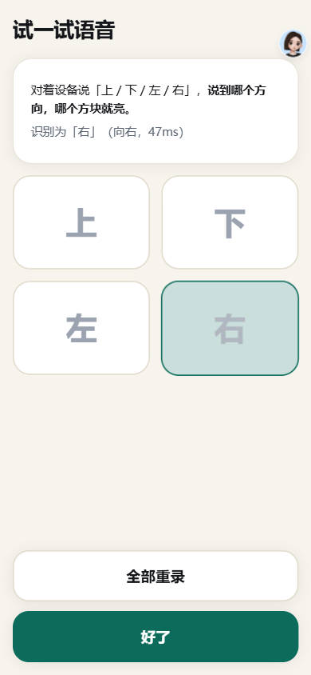
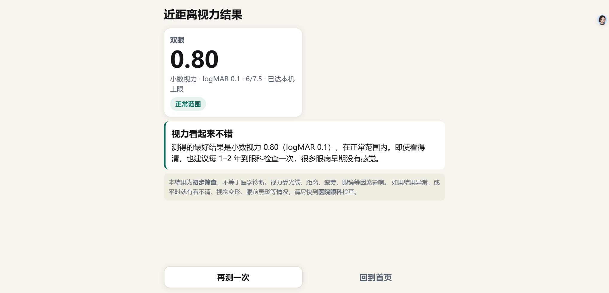

# 视力筛查程序（老人友好版）

> 面向手机（竖屏）与安卓一体机（横屏）的视力筛查网页程序，主要服务老年人群。
> 算法参考 WHO / CERA 的 WHOeyes（tumbling E + 阶梯法），并针对适老化做了大量改造。
> v0.5 起语音识别与手势识别改由 **Python AI 后端**（SenseVoice + MediaPipe）提供。

## 在线访问

**前端（GitHub Pages，纯静态）**：<https://7832782.github.io/vision-screening/>

手机浏览器直接打开即可；Android Chrome / iOS Safari 可「添加到主屏幕」，像 App 一样全屏使用。

> GitHub Pages 只能托管静态页面，**没有 Python 后端**，因此在线版默认使用浏览器离线语音（需先录四个方向词）。
> 要用「Python 高精度语音」和「手势作答」，需要在本机运行 `server/start.bat`，再用 HTTPS 隧道访问，详见
> [`docs/Python-AI后端.md`](docs/Python-AI后端.md)。

### 界面预览

| 语音试音（HTTPS） | 手势试音（骨架叠加） | 近距测试结果 |
|---|---|---|
|  |  |  |

---

## 现在有什么

| 文件 | 说明 |
|---|---|
| `index.html` | **完整前端，单文件**（原生 JS，无构建、无 CDN；可由 Python 服务或任意静态服务器托管） |
| `server/` | **Python AI 后端**：FastAPI + sherpa-onnx SenseVoice + MediaPipe Pose |
| `docs/Python-AI后端.md` | 后端架构、接口协议、实测数据、部署方式 |
| `docs/WHOeyes-逆向分析.md` | 从 WHOeyes 2.6.3 的 APK 里逆出来的算法细节（常量、公式、判定逻辑） |
| `docs/设计与决策.md` | 改进点的技术论证 + 实现决策 + 后续路线 |
| `shots/` | 手机竖屏 / 一体机横屏的界面截图 |

## 怎么跑

### 方式 A：只跑前端（最快，纯离线）

- 手机：把 `index.html` 发到手机，用浏览器打开；或放到任意静态服务器。
- 一体机：`python -m http.server 8080` 后访问 `http://<一体机IP>:8080/index.html`，建议全屏。

### 方式 B：跑 Python AI 后端（推荐，语音/手势全功能）

```powershell
cd "F:\DeepSeek Harness\项目\vision-screening"
python -m pip install -r server/requirements.txt
python server/download_models.py          # 首次下载模型（约 165 MB）
cd server
python app.py                             # 或双击 start.bat
```

- 本机打开 <http://127.0.0.1:8000/>
- 同一 Wi-Fi 的手机打开 `http://<电脑 IP>:8000/`（启动时会打印局域网 IP）
- 手机要开麦克风/摄像头必须是 HTTPS：用 `tools/cloudflared.exe tunnel --url http://127.0.0.1:8000`
  生成 `https://xxx.trycloudflare.com` 后访问（详见 `docs/Python-AI后端.md`；cloudflared 未入库，首次需按文档下载）

> 部署形态：手机 / Android 一体机只跑浏览器；Python 后端跑在同一 Wi-Fi 下的电脑上。
> 一体机本身不运行 Python；现场没有电脑时，只能使用浏览器离线语音（手势不可用）。

## 已实现

- 远距（2 米标准，可切 1.5 / 1 米，或**自定义 1–5 米任意距离**）与近距（40 厘米，可切 33/45）两套测试
- **Python 语音作答（推荐）**：SenseVoice int8 + Silero VAD，说「向上 / 向下 / 向左 / 向右」直接作答；
  不需要录模板，能识别「看不清 / 看不见 / 不知道」（记为猜错）；WebSocket 流式，说完约 0.4 秒出结果
- **手势作答**：MediaPipe Pose 检测手臂指向，支持上 / 下 / 左 / 右；测试页有画中画摄像头预览 + 骨架叠加，
  6 帧多数投票 + 4 帧迟滞防抖
- **浏览器离线语音（备用）**：没有 Python 后端时，录四个方向词 + MFCC/DTW 在本机识别，不联网
- **语音试音页 / 手势试音页**：现场验证——说到/指到哪个方向，哪个方块亮；语音识别不准可点正确方向补模板
- **屏幕校准**：用身份证短边 54 mm、硬币、A4/A5/A6 纸等标准物，拖动端点或滑条对齐
- tumbling E 视标 + 拥挤框（框厚 = E 的笔画宽，间距 = E 高度的一半）
- 视标尺寸按 `tan(5×MAR) × 距离` 计算，并**吸附到整数设备像素**（避免小视标被抗锯齿糊掉）
- 阶梯法：每组 5 个，答对 4 个过组；通过 +2 档、首次失败回退 1 档复测，定档后结算
- 结果给出 **小数视力 / logMAR / Snellen** 与三档建议（正常 / 稍差 / 尽快就医）
- 适老化：超大字号与按钮、四方向大按键、可滑动作答、外接键盘方向键、语音提示、按键音、暂停
- 设备能力自检：自动算出「本机最高可测到多少」，屏幕分辨率不够时明确提示
- 历史记录（存本机 localStorage）、全屏、屏幕常亮（Wake Lock）

## AI 实测（2026-11-07，R5 5600 CPU）

| 模块 | 结果 |
|---|---|
| 语音离线准确率 | `_test` 48/48 = 100%，`_test2` 117/117 = 100% |
| 语音流式 VAD | 165/165 每文件恰好 1 个 final，方向全部正确 |
| 语音延迟 | 解码 p50 42 ms；说完→final p50 376 ms / p95 668 ms |
| 语音抗噪 | 20/15/10 dB 白噪声：85.4% / 79.2% / 79.2% |
| 手势测试 | `server/test_pose.py` 36/36 PASS |
| 手势延迟 | p50 20–22 ms / p95 21–25 ms（含 JPEG 解码 + 推理） |
| 端到端浏览器测试 | 假麦克风喂 4 个方向词，语音试音页全部正确；24 题近距测试全部由语音答对并正常出结果 |

复现：

```powershell
python server/test_asr.py     # 21/21 硬性检查 PASS
python server/test_pose.py    # 36/36 ALL PASS
```

> 测试用的语音语料（`_test/`、`_test2/`）和手势图片（`_pose_test/`）是本地生成、未入库；
> 运行前请先用 `tools/make_voice_samples.ps1` 等脚本准备，否则对应测试会报错。

## 还没做（按优先级）

1. **摄像头实时测距**：用前置摄像头 + 人脸尺寸估计距离，随距离自动缩放视标（免去量距离）
2. 手机当遥控器（一体机场景）：屏幕显示二维码，家属手机扫码后按方向
3. 距离标尺：可打印的 2 米 / 40 厘米纸带模板
4. 结果导出（CSV / 图片）与打印
5. PWA 化（可安装到桌面、离线缓存）
6. 每字母 0.02 logMAR 的精细计分（目前是 WHOeyes 的 4/5 过组规则，偏保守约 0.05–0.15 档）

## 免触作答方案对比

| 方案 | 要不要看屏幕 | 硬件要求 | 国内可用性 | 状态 |
|---|---|---|---|---|
| 蓝牙遥控器（方向键） | 不用 | 20 元遥控器 | ✅ | ✅ 已支持 |
| **Python 语音（SenseVoice）** | 不用 | 麦克风 + 本机 Python | ✅ 离线 | ✅ 已实现 |
| 浏览器离线语音（DTW） | 不用 | 麦克风 | ✅ 不联网 | ✅ 已实现（备用） |
| **摄像头手势（MediaPipe Pose）** | 不用 | 摄像头 + 本机 Python | ✅ 离线 | ✅ 已实现 |
| 一键外接键盘 | 不用 | 键盘 | ✅ | ✅ 已支持 |
| 手机遥控（扫码） | 不用 | 同一 WiFi | ✅ | 计划中 |

## 算法自检（模拟被测者）

用心理测量曲线模拟不同视力的人，各跑 3 次：

| 模拟真值 logMAR | 测得值 | 平均 |
|---|---|---|
| 0.0（小数 1.0） | 0.1, 0.1, 0.1 | 0.10 |
| 0.3（小数 0.5） | 0.4, 0.3, 0.3 | 0.33 |
| 0.6（小数 0.25） | 0.8, 0.7, 0.8 | 0.77 |

偏差方向是"偏保守"（把人测得更差），对筛查场景可以接受：宁可多转诊，不漏诊。

## 免责声明

本程序是**初步筛查工具**，不是医疗器械、不做诊断。结果受光线、距离、疲劳、眼镜状态等影响。
结果异常或平时就有视物模糊、变形、黑影等症状，请到医院眼科检查。
