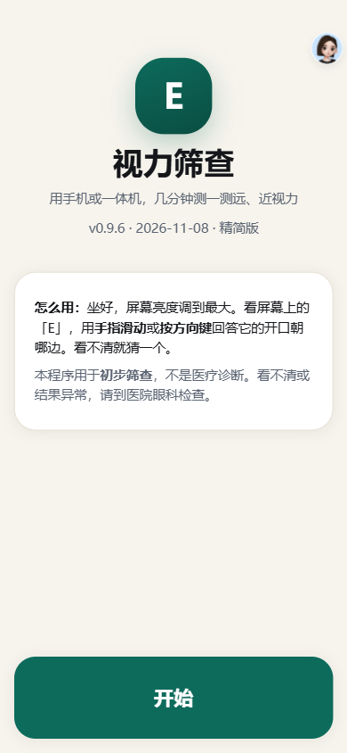
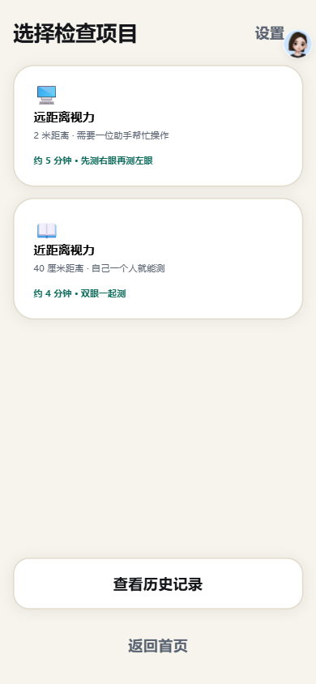
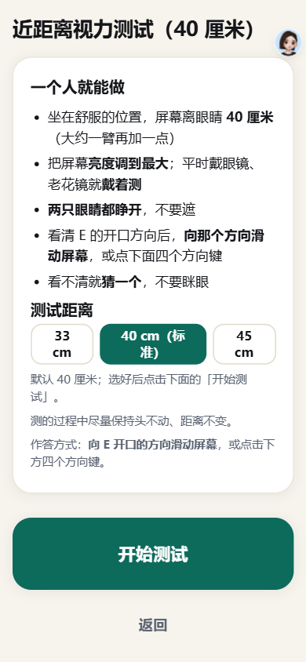
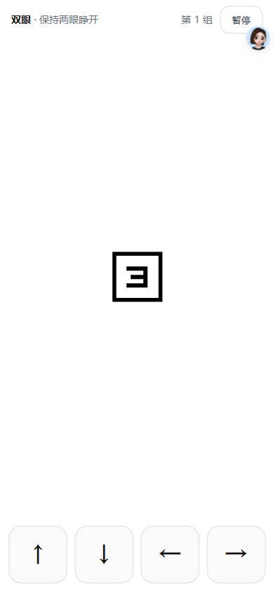
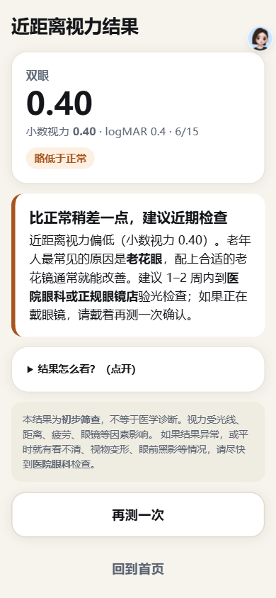
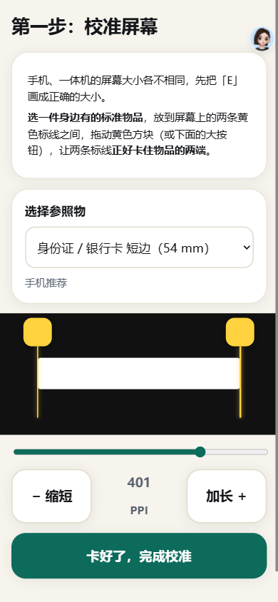
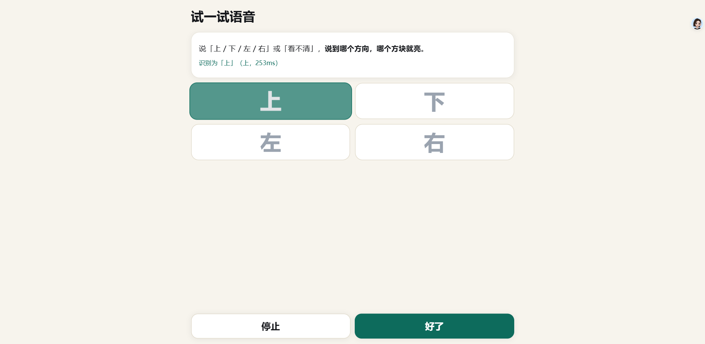
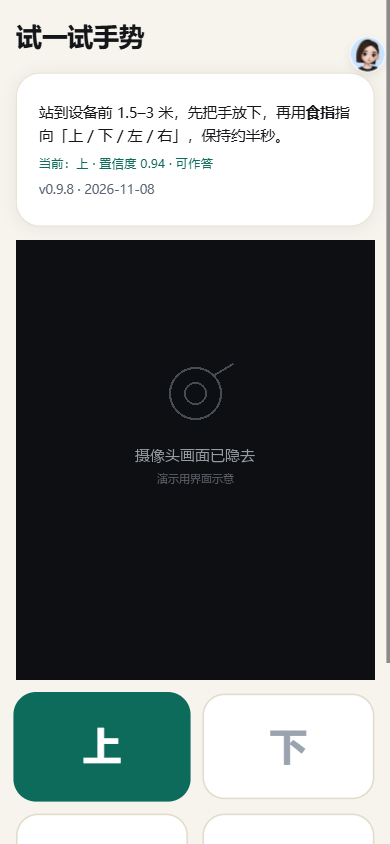
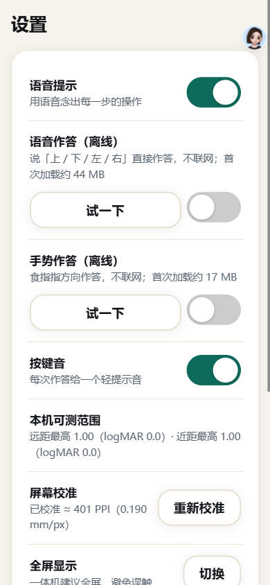
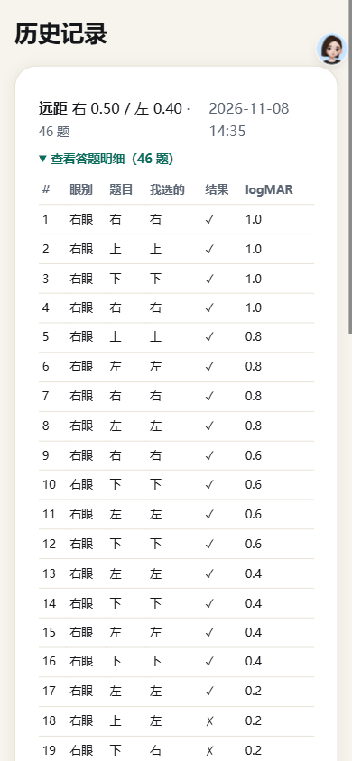

# 视力筛查程序（老人友好版）

一个**纯静态网页**的视力筛查工具：手机竖屏、安卓一体机横屏都能用，主要服务老年人群。
算法参考 WHO / CERA 的 **WHOeyes**（tumbling E + 阶梯法），逆向过程见 [`docs/WHOeyes-逆向分析.md`](docs/WHOeyes-逆向分析.md)。

**当前版本 `v0.9.6`** · 2026-11-08 · 精简版 · 版本号同时显示在欢迎页、设置页和手势试音页。

> 它是**初步筛查工具**，不是医疗器械、不做诊断。用途是「这个人该不该去医院查」，不是「这个人视力多少」。

## 在线访问

**https://7832782.github.io/vision-screening/**

手机浏览器直接打开；一体机建议在设置里点「全屏显示」。
语音 / 手势需要 HTTPS（GitHub Pages 自带）并允许麦克风 / 摄像头。

## 界面

| 欢迎 | 首页 | 选距离 |
|---|---|---|
|  |  |  |

| 测试 | 结果 | 校准 |
|---|---|---|
|  |  |  |

| 语音试音 | 手势试音 | 设置 |
|---|---|---|
|  |  |  |

| 历史逐题明细 | | |
|---|---|---|
|  | | |

> 截图统一按 `v0.9.6` 重新截过（手机竖屏 390×844 @3x）。图里的版本号和线上页面一致，
> 对不上就说明你看到的是旧缓存。

## 功能总览

| 能力 | 状态 | 说明 |
|---|---|---|
| 远距测试 | ✅ 可用 | 2 米默认，可选 1.5 / 1 / 自定义 1–5 米 |
| 近距测试 | ✅ 可用 | 33 / 40 / 45 cm，**在测试说明页选**，默认 40（标准） |
| 屏幕校准 | ✅ 可用 | 实物比对：身份证 54 / 85.6 mm、A6 / A5 / A4 短边、1 元硬币，或自定义任意毫米数 |
| 按键 / 滑动作答 | ✅ 可用 | 四个大方向键（上/下/左/右）+ 全屏滑动 + 外接键盘方向键 |
| 离线语音作答 | ✅ 可用 | Vosk WASM 本地模型，约 44 MB；说「上/下/左/右」，或「看不清/看不见/不知道/不清楚/看不到」 |
| 离线手势作答 | ✅ 可用 | MediaPipe Hand Landmarker，约 17 MB，**单手**食指指方向；预览画面**不裁切**，骨架与手严格对齐 |
| 结果解释 | ✅ 可用 | 小数视力 / logMAR / Snellen 三种记法 + 分级 + 「结果怎么看」 |
| 历史记录 | ✅ 可用 | 每条可展开**逐题明细**（眼别 / 题目 / 我的选择 / 对错 / logMAR） |
| 屏幕上限提示 | ✅ 可用 | 分辨率不够时显示 `≥0.20 · 受屏幕限制`，不谎报真实视力 |
| 实时测距（摄像头） | ⬜ 未做 | 见 [`docs/路线图.md`](docs/路线图.md) |
| 手机当遥控器 | ⬜ 未做 | 一体机场景的二维码 + 局域网方向键 |
| 结果导出 / 打印 | ⬜ 未做 | CSV、图片、打印版报告 |

语音 / 手势**默认关闭**：只有你在设置里打开，才会去申请麦克风和摄像头权限。

## 怎么用（三步）

1. **校准屏幕**（首次使用）：拿一张身份证 / 银行卡贴屏幕，拖手柄对齐长边或短边 → 程序算出 PPI，存本地，以后不用再校准。
2. **选距离 → 开始**：远距先选 1 / 1.5 / 2 / 自定义米数，近距先选 33 / 40 / 45 cm，再点「开始测试」。
3. **遮一只眼，看 E 的开口方向作答**：答对 4 个进下一档，错 2 个定档；两只眼分别测完出结果。

远距开启语音 / 手势后**一个人就能做**：设备放桌面或支架，2 米外指着答就行；换眼有 5 秒倒计时自动继续。

## 怎么跑

```bash
# 任意静态服务器都行；语音 WASM 和手势 ES module 必须走 HTTP(S)，不能 file://
python -m http.server 8080
# 手机访问 http://<电脑IP>:8080/index.html，一体机建议全屏
```

**不要双击 `index.html`**——`file://` 下语音和手势模块加载不了，这是浏览器限制。

## 目录结构

```
vision-screening/
├── index.html                 主程序（单文件：CSS + 10 个页面 + 内联脚本，1869 行）
├── icon-192.png               浏览器标签页图标
├── voice/                     离线语音模块（Vosk WASM + 中文小模型）
│   ├── vosk.js                运行时（5.5 MB）
│   ├── model.tar.gz           中文小模型（43.8 MB）
│   └── engine.js              给主页面的封装
├── gesture/                   离线手势模块（MediaPipe Hand Landmarker）
│   ├── vendor/                tasks-vision WASM（本地，不走 CDN）
│   ├── models/                hand_landmarker.task（7.5 MB）
│   ├── hand_rules.js          21 点 → 上/下/左/右
│   ├── gesture_gate.js        动作激活 + 保持确认 + 每题一次
│   └── engine.js              摄像头封装 + 骨架绘制
├── docs/                      设计与验收文档（见下方文档地图）
├── shots/                     界面截图
└── tools/                     图标生成、语法自检等小脚本
```

仓库体积 **76 MB**，其中语音模型 47.4 MB、手势模型与 WASM 27 MB，**代码本身不到 0.2 MB**。
没有 npm、没有 node_modules、没有构建步骤。

## 技术要点（一屏版）

- **视标高度**：`h = tan(5·10^logMAR 弧分) × 距离`；E 的笔画 = 高度的 1/5。
- **像素吸附**：只有当视标高度接近 5 的整数倍设备像素（误差 ≤10%）时才吸附，否则按精确物理尺寸绘制。
  这条规则解决了「不同距离下像素对齐碰巧好 / 碰巧差，导致可测上限跳档」的 bug。
- **可测上限**：`maxRenderableIndex()` 从最高档往下找第一个**笔画 ≥ 1 设备像素**的档位，结果随距离单调变化。
  到顶了不是测不出，是这块屏幕画不出来——界面上明说 `≥X · 受屏幕限制`。
- **阶梯法**：每组 5 个视标、**答对 4 个通过**、通过后 **+2 档**；首次失败记下档位，回退 1 档做确认，
  比 WHOeyes 少了它那一次冗余回头（结论等价、题量更少）。
- **拥挤框**：框线宽 = E 的笔画宽，框与 E 的间距 = E 高度的一半（ETDRS 拥挤效应）。
  屏幕太小时优先保 E 的真实尺寸，压缩 / 隐藏拥挤框，不缩小视标。
- **手势预览不裁切**：摄像头画面用 `object-fit: contain`（不是 `cover`），预览框还会跟随实际画面比例。
  `cover` 会把画面上下裁掉一百多像素，手机竖屏时举起的手直接被裁到框外 —— 看起来就像"点对不上手"。
- **无构建、无 CDN**：一体机往往是老 Android WebView，任何 CDN 依赖都可能加载失败；断网也要能用。

## AI 模块实测

| 模块 | 结果 |
|---|---|
| 离线语音（浏览器 Vosk WASM，本页集成版） | 真人 24 条 **20/24 = 83.3%**；TTS 12/12；合计 32/36 = 88.9% |
| 离线手势（MediaPipe Hand PWA） | 示例图 **4/4**；离线重载 4/4；闸门单测 **7/7**；GPU 单帧约 11 ms |
| 服务端双模型（未接入，可作「高精度模式」） | 真人 **24/24 = 100%**；HTTP p50 **111 ms** |

完整的样本来源、失败分析和整合冒烟记录见 [`docs/AI模块验收.md`](docs/AI模块验收.md)。
55 MB 左右的模型换来 83.3%——这是纯静态、纯离线方案的上限；要在现场提到 100% 需要一台局域网后端。

## 结果怎么看

| 记法 | 含义 | 怎么看 |
|---|---|---|
| 小数视力 | 国际常用的 0.1–1.0 记法 | **越大越好**；正常成年人一般 ≥1.0，0.25 偏低 |
| logMAR | 最小分辨角的对数 | **0 最好，越大越差**；每 0.1 约差一行 |
| Snellen | 6/6、6/24 这类分数 | 正常 6/6；6/24 = 6 米处看清正常眼 24 米处能看清的视标 |

分级参考（筛查用，不是诊断）：≥0.63（logMAR ≤0.2）正常；0.4–0.5（0.3–0.4）略低；≤0.32（logMAR ≥0.5）明显下降。

## 已知限制

- **近距测试对低 PPI 大屏是死路**：1080p 21.5″ 一体机在 40 cm 处最高只能到小数 0.25。近距请用手机 / 平板（约 400 PPI）或 4K 屏。
- **距离要靠人量**：卷尺或地面胶带最稳；步长估算误差 5–10%，不推荐。
- **浏览器整页缩放会毁掉校准**（`Ctrl +/-`、部分国产浏览器的「页面缩放」）。
- **语音 83.3%**：单模型上限，失败样本与 Python Vosk 完全一致；安静环境下明显更好。
- **手势**：40 cm 纯手部大特写检不到，要「脸 + 手都在画面」；2 米建议 640×480 以上。预览不裁切，
  所以画面比例和框不一致时会留一点黑边——这是故意的，宁可留黑边也不让手跑出画面。
- **真实老人数据还没采过**，11-11 计划找 3–5 位试用。

## 算法自检（模拟被测者）

| 模拟真值 logMAR | 测得值 | 平均 |
|---|---|---|
| 0.0（小数 1.0） | 0.1, 0.1, 0.1 | 0.10 |
| 0.3（小数 0.5） | 0.4, 0.3, 0.3 | 0.33 |
| 0.6（小数 0.25） | 0.8, 0.7, 0.8 | 0.77 |

偏差方向是**偏保守**（把人测得更差），对筛查场景可以接受：宁可多转诊，不漏诊。

## 文档地图

| 文档 | 什么时候读 |
|---|---|
| [`docs/架构与代码.md`](docs/架构与代码.md) | 要改代码：分区、数据流、函数表、全局状态 |
| [`docs/设计与决策.md`](docs/设计与决策.md) | 想搞清「为什么这么设计」：校准、距离、上限、作答方式的论证 |
| [`docs/WHOeyes-逆向分析.md`](docs/WHOeyes-逆向分析.md) | 想核对算法：APK 逆向出来的档位表、公式、阶梯逻辑 |
| [`docs/AI模块验收.md`](docs/AI模块验收.md) | 想核对语音 / 手势的测试数字与样本 |
| [`docs/版本史.md`](docs/版本史.md) | 想知道每个版本改了什么、踩过哪些坑 |
| [`docs/实验归档/`](docs/实验归档/) | 想核对语音 / 手势的原始实验报告（原实验目录已删） |
| [`docs/路线图.md`](docs/路线图.md) | 想知道接下来做什么、还差什么 |
| [`voice/README.md`](voice/README.md) · [`gesture/README.md`](gesture/README.md) | 只关心某个 AI 模块怎么接 |
| [`AGENTS.md`](AGENTS.md) | 给下一次接手这个仓库的 AI 看的硬规则 |

## 免责声明

本程序是**初步筛查工具**，不是医疗器械、不做诊断。结果受光线、距离、疲劳、眼镜状态等影响。
结果异常或平时就有视物模糊、变形、黑影等症状，请到医院眼科检查。
